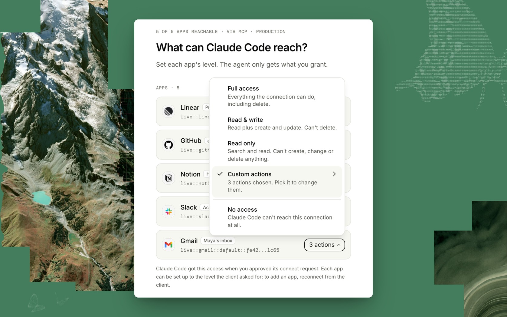
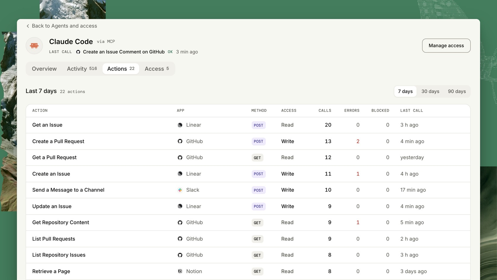

<p>
  <a href="https://withone.ai/products/mcp">
    
  </a>
</p>

<h3 align="center">One MCP Server</h3>

<p align="center">
  <a href="https://withone.ai/docs/install"><strong>Setup guides</strong></a>
  &nbsp;&middot;&nbsp;
  <a href="https://withone.ai/docs/mcp"><strong>Docs</strong></a>
  &nbsp;&middot;&nbsp;
  <a href="https://withone.ai/knowledge"><strong>API directory</strong></a>
  &nbsp;&middot;&nbsp;
  <a href="https://withone.ai"><strong>Website</strong></a>
  &nbsp;&middot;&nbsp;
  <a href="https://app.withone.ai"><strong>Dashboard</strong></a>
  &nbsp;&middot;&nbsp;
  <a href="https://withone.ai/changelog"><strong>Changelog</strong></a>
</p>

<p align="center">
  <a href="https://npmjs.com/package/@withone/mcp"></a>
  &nbsp;
  <a href="https://withone.ai/knowledge"></a>
  &nbsp;
  <a href="https://withone.ai/knowledge"></a>
  &nbsp;
  <a href="./LICENSE"></a>
</p>

One's [MCP](https://modelcontextprotocol.io) server gives your agent the apps you have connected on One. It has three tools, however many platforms and actions sit behind them, and the agent never sees an OAuth token or an API&nbsp;key.

There are two ways to run&nbsp;it.

- **The remote server, which we recommend.** One hosts it at `https://mcp.withone.ai/mcp`. Point your client at that URL, sign in to One in the browser and choose what the agent can reach. There is nothing to install and no API&nbsp;key.
- **This package.** `@withone/mcp` runs the same three tools on your machine over stdio, with an API key. Use it for clients without remote support, headless machines and&nbsp;Docker.

## Quick start

Add the remote server to your client. On first connect the client opens a browser, where you sign in to One and pick what the agent can&nbsp;reach.

**Claude Code**

```bash
claude mcp add --transport http one https://mcp.withone.ai/mcp
```

Then run `/mcp` inside Claude Code, pick `one` and choose&nbsp;Authenticate.

**Codex**

Add One to `~/.codex/config.toml`, then sign in with `codex mcp login one`.

```toml
[mcp_servers.one]
url = "https://mcp.withone.ai/mcp"
```

**Cursor and VS Code**

[](https://cursor.com/en/install-mcp?name=one&config=eyJ1cmwiOiAiaHR0cHM6Ly9tY3Aud2l0aG9uZS5haS9tY3AifQ==)
[](https://vscode.dev/redirect/mcp/install?name=one&config=%7B%22type%22%3A%20%22http%22%2C%20%22url%22%3A%20%22https%3A%2F%2Fmcp.withone.ai%2Fmcp%22%7D)
[](https://insiders.vscode.dev/redirect/mcp/install?name=one&config=%7B%22type%22%3A%20%22http%22%2C%20%22url%22%3A%20%22https%3A%2F%2Fmcp.withone.ai%2Fmcp%22%7D)

In Windsurf, One is in the MCP marketplace, which reads the MCP Registry entry `ai.withone/mcp`.

**Any other client**

The server speaks the Streamable HTTP transport. A client with a config file takes the entry below, and a client with a settings screen needs only the&nbsp;URL.

```json
{
  "mcpServers": {
    "one": {
      "type": "http",
      "url": "https://mcp.withone.ai/mcp"
    }
  }
}
```

Some clients name the keys differently. There is a step-by-step guide for [Claude Code](https://withone.ai/docs/install/claude-code), [Codex](https://withone.ai/docs/install/codex), [Claude Cowork](https://withone.ai/docs/install/claude-cowork), [ChatGPT](https://withone.ai/docs/install/chatgpt), [Cursor](https://withone.ai/docs/install/cursor), [Devin](https://withone.ai/docs/install/devin), [Kiro](https://withone.ai/docs/install/kiro), [OpenClaw](https://withone.ai/docs/install/openclaw) and [Hermes](https://withone.ai/docs/install/hermes), and the [setup guides](https://withone.ai/docs/install) cover Gemini CLI and the&nbsp;rest.

**Then ask your agent**

> Get my last 5 emails from&nbsp;Gmail

> Post the release notes to #general in&nbsp;Slack

> Build a form that creates a HubSpot&nbsp;contact

## Remote or local

Use the remote server wherever your client supports&nbsp;one.

| | Remote server | Local `@withone/mcp` |
|---|---|---|
| **Setup** | A&nbsp;URL | Node.js 22.23.4+, 24.22.1+ or 26.12.1+, run with&nbsp;`npx` |
| **Sign-in** | OAuth in the&nbsp;browser | An API key in&nbsp;`ONE_SECRET` |
| **Scoping** | The consent screen, editable from the&nbsp;dashboard | Environment variables, or limits set on the&nbsp;key |
| **Approval before writes** | Your client's own confirmation, prompted by the tool&nbsp;annotations | `ONE_APPROVAL`, through MCP&nbsp;elicitation |
| **Transport** | Streamable&nbsp;HTTP | stdio |
| **Good for** | Every client that supports remote&nbsp;servers | Clients without remote support, headless machines with no browser, Docker and per-user identity&nbsp;scoping |

The [MCP Registry](https://registry.modelcontextprotocol.io) lists both under `ai.withone/mcp`, the remote URL and the npm&nbsp;package.

## The three tools

| Tool | What it does | Annotations |
|------|--------------|-------------|
| `list_one_integrations` | Lists your connected apps, each with its connection key and the access it&nbsp;allows | Read-only |
| `find_one_actions` | Finds the action for every operation a task needs, across platforms, in one call, with its&nbsp;documentation | Read-only |
| `execute_one_action` | Runs an action on a connected&nbsp;app | Destructive, open-world |

The agent calls `list_one_integrations` first, then `find_one_actions` with every operation the task needs, then `execute_one_action` for each one. The remote server sends these instructions when the client connects. The local server does not, and you can add the workflow to your agent's prompt if it does not follow&nbsp;it.

`execute_one_action` is the only tool that can change anything. Its annotations mark it destructive, which lets your client ask before it&nbsp;runs.

### Find actions

Send one entry in `requests` for each operation, as a kebab-case `platform` and a short `intent` that names the operation alone, without IDs, names or message&nbsp;text.

```json
{
  "requests": [
    { "platform": "gmail", "intent": "send an email" },
    { "platform": "hubspot", "intent": "find a contact by email" }
  ],
  "task": "email a report to a CRM contact",
  "ai_model": "claude-sonnet-5"
}
```

`requests` takes 1 to 10 operations. `task` is the whole job in one general line, which helps choose between similar actions, and `ai_model` names the model that is&nbsp;asking.

Each answer names the chosen action with its documentation, plus a few alternatives. When One is unsure, it sets a substitute apart. Large documents come back as a digest that lists the sections it left out. Call again with `load: [{ action_id, section }]` in place of `requests` to read a section, the table of contents, the whole document or an alternative. Results only include actions the agent is allowed to&nbsp;run.

A platform name One does not have, such as `clickup` for `click-up`, is not searched. The answer names the platforms it may have meant, and the agent can ask&nbsp;again.

### Execute an action

The two servers take the same arguments under different names. The remote server uses snake_case and the local package uses&nbsp;camelCase.

| Remote server | Local package | What it is |
|---------------|---------------|------------|
| `action_id` | `actionId` | The action to run, from `find_one_actions` or from a connection's `access` list.&nbsp;Required |
| `connection_key` | `connectionKey` | The connection to run it on, from `list_one_integrations`.&nbsp;Required |
| | `platform` | The connection's platform. Required on the local package&nbsp;only |
| `data` | `data` | The request body, JSON by&nbsp;default |
| `path_variables` | `pathVariables` | Values for the `{var}` placeholders in the action's&nbsp;path |
| `query_params` | `queryParams` | Query-string&nbsp;parameters |
| `headers` | `headers` | Extra headers to send to the&nbsp;platform |
| `is_form_url_encoded` | `isFormUrlEncoded` | Send `data` as&nbsp;`application/x-www-form-urlencoded` |
| | `isFormData` | Send `data` as multipart. The remote server does not support it&nbsp;yet |
| `ai_model` | | The model the agent runs as, recorded with the&nbsp;call |

One resolves the connection and its credentials on its side, makes the call and returns `responseData`, `status` and `requestConfig`, a copy of the request with credentials redacted. A platform error comes back as a normal result that carries its `status`. Only a refusal from One is a tool&nbsp;error.

Upgrading from 1.x? `search_one_platform_actions` and `get_one_action_knowledge` are removed, and `find_one_actions` replaces&nbsp;both.

## Choose what the agent can&nbsp;reach

On the remote server, the consent screen decides what the agent gets. Pick the account and environment, then give access to all connections or tick specific ones and set a level for&nbsp;each.

| Level | What the agent can run |
|-------|------------------------|
| **Full access** | Every action on the connection, including&nbsp;deletes |
| **Read & write** | Actions that read or change data, but no&nbsp;deletes |
| **Read only** | Actions that only read&nbsp;data |
| **Custom** | Only the actions you&nbsp;tick |

A level is judged by what each action does, not by its HTTP method. One classifies every action as read, write or delete, which means a search sent as a POST runs under Read&nbsp;only.

One enforces the grant on every call. An action outside it is never offered to the agent, and a call that names one anyway is refused. Each connection in `list_one_integrations` carries an `access` field, which tells the agent what it can run before it looks for&nbsp;actions.

**Knowledge only mode** lets the agent read API documentation and nothing else. It is built for code generation. The agent gets `find_one_actions` alone, and each document comes back whole with how to call the action from your own code. Turn it on from the consent&nbsp;screen.

**To change or revoke access**, open Agents and access in the [One dashboard](https://app.withone.ai). Change a connection's level or remove it, and the change applies on the agent's next call, with no reconnect. An edit can narrow or restore what you first granted. To grant more, reconnect and approve&nbsp;again.

<p>
  
</p>

The docs cover the [consent screen](https://withone.ai/docs/mcp#authorize-and-scope-access), the [errors and refusals](https://withone.ai/docs/mcp#errors-and-refusals) and the [OAuth details](https://withone.ai/docs/mcp#connection-details) for anyone building a&nbsp;client.

## Run the package locally

The package needs Node.js 22.23.4+, 24.22.1+ or 26.12.1+ and an API key from the [One dashboard](https://app.withone.ai/settings/api-keys). Add it to your client's MCP&nbsp;config.

```json
{
  "mcpServers": {
    "one": {
      "command": "npx",
      "args": ["-y", "@withone/mcp"],
      "env": {
        "ONE_SECRET": "your-one-api-key"
      }
    }
  }
}
```

Or run it by&nbsp;hand.

```bash
ONE_SECRET=your-one-api-key npx -y @withone/mcp
```

Older Node releases trust the compromised eMudhra CA certificates (October 2026), and a network attacker could read `ONE_SECRET`. On one of them the server still starts, but every tool returns an error with the command that updates&nbsp;Node.

### Configuration

Scope the local server with environment variables in place of a consent&nbsp;screen.

| Variable | Default | Description |
|----------|---------|-------------|
| `ONE_SECRET` | | Your API key.&nbsp;Required |
| `ONE_PERMISSIONS` | `admin` | `read` allows read actions only, `write` allows read and write actions, and `admin` allows everything, including deletes. Judged by what each action does, not its HTTP method. Below `admin`, an action with no classification is&nbsp;refused |
| `ONE_APPROVAL` | `off` | Ask you before an action runs. `write` asks before writes and deletes, and `delete` asks before deletes only. See&nbsp;[Approval](#approval) |
| `ONE_CONNECTION_KEYS` | `*` | Comma-separated connection keys the agent may use. `find_one_actions` only searches their&nbsp;platforms |
| `ONE_ACTION_IDS` | `*` | Comma-separated action IDs the agent may find and&nbsp;run |
| `ONE_KNOWLEDGE_AGENT` | `false` | `true` removes `execute_one_action`. `find_one_actions` then returns each document whole, with how to call the action from&nbsp;code |
| `ONE_IDENTITY`, `ONE_IDENTITY_TYPE` | | Only list and run connections that belong to one identity. The type is `user`, `team`, `organization` or&nbsp;`project` |
| `ONE_BASE_URL` | `https://api.withone.ai` | The One API the server&nbsp;calls |
| `ONE_ALLOW_UNPATCHED_NODE` | | `1` lets the server call One from an older Node.js. You stay exposed while it is&nbsp;set |

An invalid `ONE_PERMISSIONS` or `ONE_APPROVAL` stops the server at startup. With no variables set beyond the key, the server has full access and all three&nbsp;tools.

Whatever you set is reported back to the agent. `list_one_integrations` stamps each connection with an `access`&nbsp;field.

| `access` | When |
|----------|------|
| `{ "policy": "full" }` | No action allowlist and `ONE_PERMISSIONS=admin`. Every action is&nbsp;runnable |
| `{ "policy": "levels", "levels": ["read"] }` | `ONE_PERMISSIONS` is `read` or `write`. Only actions at these levels are&nbsp;runnable |
| `{ "policy": "actions", "actions": [...] }` | `ONE_ACTION_IDS` is set. Exactly these actions are runnable, and no search is&nbsp;needed |

### Approval

An agent that has just read an email, a web page or another third-party document can be steered by what it read. With `ONE_APPROVAL` set, the person at the MCP client decides whether a change goes ahead, not the&nbsp;agent.

Before `execute_one_action` runs an action that needs approval, the server shows a prompt through [MCP elicitation](https://modelcontextprotocol.io/specification/latest/client/elicitation). It names the action, the platform, the connection and what will be sent, and you tick a box to run it. Declining, dismissing or not answering within 10 minutes stops the action, and nothing is&nbsp;sent.

Your MCP client has to support elicitation. If it does not, every action that needs approval is refused. Check your client before you turn this&nbsp;on.

### Docker

```bash
docker build -t one-mcp .
docker run -i --rm -e ONE_SECRET=your-one-api-key one-mcp
```

`-i` keeps stdin open, which a stdio server needs. Pass any variable above with another&nbsp;`-e`.

### Limits on the key

The variables are enforced by the local server. To enforce limits on One's side for anything that uses the key, set them on the key itself in the dashboard. If the [One CLI](https://github.com/withoneai/cli) is installed, `one config` keeps the variables of an existing `one` server entry in step with the CLI's own&nbsp;settings.

## Build it into your product

Does your product run its own AI agent for its users? It can skip the browser sign-in. [Connect](https://github.com/withoneai/connect) is One's embeddable authentication, which you add to your product for your users to connect their own apps. Your server then gets a 15-minute token for a connected user, and your agent uses the remote server with that token, within what the user&nbsp;granted.

```ts
const { accessToken, url } = await oneConnect.getMcpToken(userId);
// url is https://mcp.withone.ai/mcp
```

See [Give your agent the MCP server](https://withone.ai/docs/connect/mcp).

## Security

Your agent never handles a platform credential. One stores the OAuth tokens and API keys for your connections and adds them on its side on each call. The remote server authenticates your agent with a short-lived OAuth token tied to the grant you approved, and the local package's only credential is `ONE_SECRET`. Credentials are redacted from every response, and sensitive headers are stripped from the request&nbsp;echo.

Every call is recorded against the agent or the key that made it. Open either one in Agents and access to see each action it ran, whether that action reads or writes, and how many calls One&nbsp;blocked.

<p>
  
</p>

To report a vulnerability, see [SECURITY.md](./SECURITY.md).

## Development

```bash
git clone https://github.com/withoneai/mcp.git
cd mcp
npm install        # also builds
npm test
ONE_SECRET=your-one-api-key npm run inspector
```

`npm run inspector` opens the [MCP Inspector](https://github.com/modelcontextprotocol/inspector) against your local&nbsp;build.

## Support and license

Email support@withone.ai or [open an issue](../../issues). The package is released under the [MIT license](./LICENSE).
